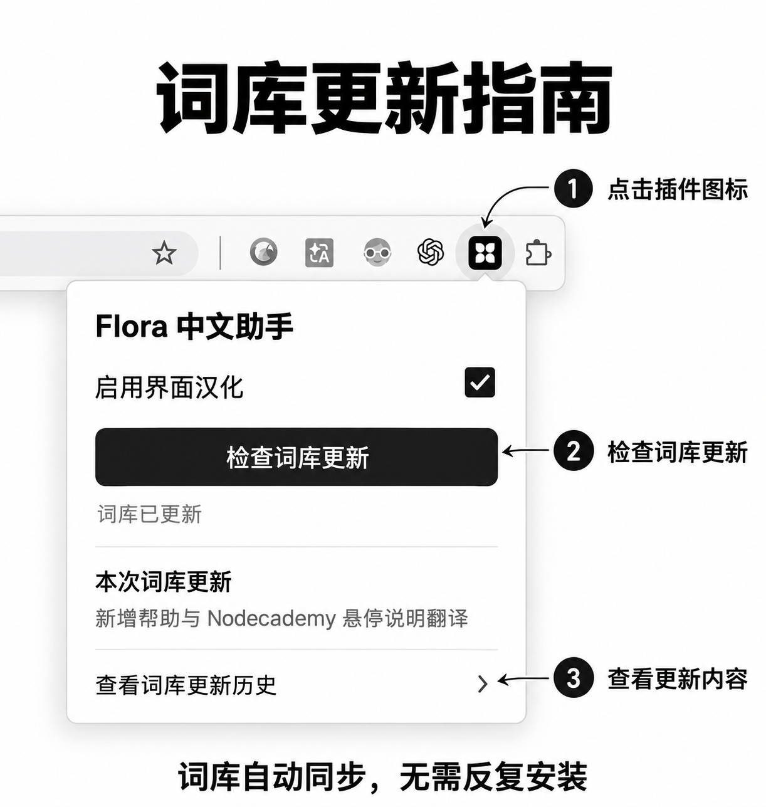

# Flora 中文助手

非官方 Chrome 扩展，为 FLORA 界面提供简体中文翻译。输入框和提示词不会发送到词库服务。

## 安装

下载本仓库，打开 Chrome 的扩展程序页面，启用开发者模式，选择「加载已解压的扩展程序」，选择包含 manifest.json 的文件夹。刷新 FLORA 页面。发布到 Chrome 网上应用店之前，扩展代码更新需要手动重新加载或重新安装。

## 词库更新

扩展每六小时及浏览器启动时检查本仓库 main 分支的 wordlist.json；弹窗中的「检查词库更新」可立即检查。成功后缓存在本地并应用到已打开的页面。离线或更新失败时保留上次成功的词库，首次安装则使用内置词库。按钮只更新翻译词库，不更新扩展代码。

词库格式：`{"format": 1, "version": "版本标识", "translations": {"English": "中文"}}`。修改词条后更新版本标识并提交到 main。对于新增的动态匹配逻辑、页面结构或扩展权限，仍需发布新扩展版本。

使用 FLORA 标识仅用于标识兼容对象，FLORA 品牌和标识属于其各自权利人；本项目与 FLORA 无官方关联。

## 词库更新指南

